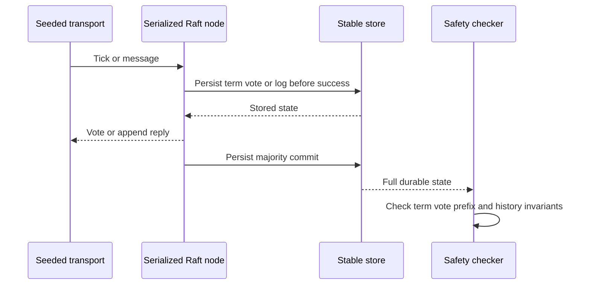

# Quorum Lab

A minority leader accepts a write, then the network heals. That write must not appear in the committed history merely because it was accepted locally. The [seed-7 history](histories/demo.json) follows this case through a replacement election, crash/restart, suffix repair, and final convergence.

`raft.Node.Propose` reports acceptance, not commitment. The committed prefix is a separate observation through `Status` or `Applied`. This distinction matters for any replicated control plane that coordinates model versions, routing rules, or worker assignments.

## Replay a partition

An actual Go 1.23+ SDK is required; the recorded run used Go 1.25.1. There are no external modules.

```bash
go run ./cmd/quorumlab demo --output artifacts/partition.json
go run ./cmd/quorumlab evaluate --output artifacts/scenarios.json
GOFLAGS=-p=2 GOMAXPROCS=2 go test -race ./...
go vet ./...
go build -o artifacts/quorumlab ./cmd/quorumlab
```

The binary and `go run` use the same `demo|evaluate [--output PATH]` interface. Failed scenarios exit 1; invalid CLI/output failures exit 2. `make test GO=/path/to/real/go` also accepts an explicit SDK path.

## Persistence before a reply



Elections use randomized deadlines and last-term/last-index freshness. A leader writes a current-term no-op, replicates bounded batches, and commits only a current-term entry with majority evidence. Follower commit is bounded by the prefix verified in that append; a long local tail is not proof that the leader verified it. Per-peer sequence handling prevents old failures from undoing newer replication progress.

Nodes have one serialized owner. Static three- and five-member identities are persisted and cannot be replaced through a restart. `MemoryStore` is the simulator's crash-surviving model. `FileStore` actually writes a temporary whole-state file, syncs it, renames it, and syncs the directory. Checksums detect corruption; they do not authenticate a malicious rewrite. One process owns each file, with no cross-process file lock.

## Trace the code

```text
raft/node.go                   elections, append repair and commit rules
raft/store.go                  memory and checked file persistence
raft/*_test.go                 protocol and storage regressions
simulator/                     delivery schedules and safety checking
cmd/quorumlab/                 JSON command-line interface
schedules/exploration.json     exact versioned exploration manifest
histories/                     demo and measured exploration summary
raft_notes/                    persistence barriers and protocol findings
scripts/check_protocol.py      optional unified repository checks
```

The recorded exploration covers seeds 1-12 for each cluster size: 24 scenarios of 360 ticks, with partitions, 0-15% phase-specific loss, reordering, and restart. All 24 completed their expected commands, while no minority-only command committed. The [partition histories](raft_notes/partition-histories.md) retain the manifest hash, 52,780 safety observations, and transport counts. A safety observation is not a unique explored state, and the retained trace prefix is not a complete event log.

Membership changes, snapshots, read-index/linearizable reads, real RPC, client deduplication, and external application transactions are outside this implementation. File tests exercise sync/rename/recovery but do not emulate power loss. Log, message, command, and tick budgets fail explicitly rather than silently dropping state. The [persistence and commit rules](raft_notes/persistence-and-commit.md) define those limits; [protocol regressions](raft_notes/protocol-regressions.md) describe the failures the tests guard against.
